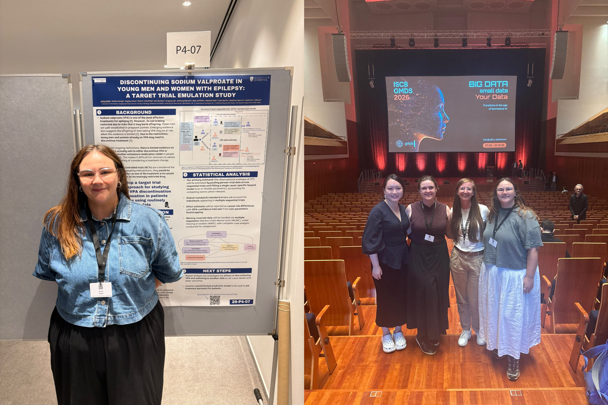
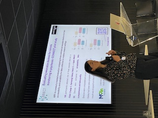

Here is a round up of what the group has been up to over the last few months!

## New Starters:

We have welcomed three new members to the group recently:

-   [Millie Stephenson](https://manchester-predictive-healthcare-group.github.io/members/milliestephenson/) started her PhD in October, supervised by Matt Sperrin and Siân Bladon. Millie is funded through the CD3 project and her PhD is focussed on the fairness of cancer risk prediction models.

-   Abbie Baker also started her PhD in October, co-supervised by Dave Jenkins. Abbie's project is looking at exploring new approaches to diagnose intracerebral haemorrhage earlier to improve patient outcomes.

-   [Hira Sahi](https://manchester-predictive-healthcare-group.github.io/members/hirasahi/) started as a pre-doctoral researcher in September, funded through the NIHR pre-doctoral award scheme. Hira recently completed her MSc in Health Data Science at Manchester and is hoping to pursue a PhD in prediction model methodology.

## Conferences and Presentations

Here is a summary of recent conferences members of the group have attended and presented at:

-   Four members of the group attended the [ISCB](https://iscbgmds2026.info/) conference in Frieburg in September. Ziyi gave a talk in the *Strategies for Prediction Models* contributed session on her scoping review of feedback loops in CPMs. [Sam](https://manchester-predictive-healthcare-group.github.io/members/samanthapacynko/) also presented a talk in the *Prediction and Treatment* session on her simulation study looking at the impact of CPM-based treatment initiation on model updating. [Molly](https://manchester-predictive-healthcare-group.github.io/members/mollywells/) had two posters, one on some PPIE work around defining sub-groups for fairness assessment and another on a target trial emulation study on discontinuing sodium valproate in epilepsy patients. [Steph](https://manchester-predictive-healthcare-group.github.io/members/stephriley/) also presented a poster on some work done in collaboration with Molly, trying to understand attitudes towards causal inference methods in applied health research.

{height="4in"}

-   [Siân](https://manchester-predictive-healthcare-group.github.io/members/sianbladon/) attended the Mental Health Platform Research Summit conference in Sheffield in October. She presented a poster and talk on the CONNECT pilot study in the *Data Science Spotlight session*. Siân also attended an ECR workshop focussed on EPR data in mental health research, TREs and federated data platforms.

{height="3in"}

-   [Dave](https://manchester-predictive-healthcare-group.github.io/members/davidjenkins/) and [Glen](https://manchester-predictive-healthcare-group.github.io/members/glenmartin/) presented at the Manchester BRC Digital Seminar Series. The seminar explored the translational gap between prediction model development and deployment in clinical practice, including the steps required to evaluate the impact of a model on healthcare processes and outcomes. 

## Papers

The following papers have been published recently:

-   PhD student Haya has had an [article](https://link.springer.com/article/10.1186/s41512-026-00245-8) published in Diagnostic and Prognostic Research titled "Validation of a prognostic model for chronic obstructive pulmonary disease (COPD) and evaluation of methods to include related data". The aim of the study was to explore potential miscalibration of a COPD prognostic model and evaluate methods to improve predictive performance by incorporating related ancillary data.
-   PhD student Kritchavat has had a [scoping review](https://link.springer.com/article/10.1186/s41512-026-00237-8) also published in Diagnostic and Prognostic Research, looking at methodology for aiding generalisability and transportability of CPMs.The study included 18 articles and categorised them into either data-driven methodologies that enhance the robustness of prediction models or knowledge-driven methodologies that integrate causal reasoning.The review highlighted that future work could explore integrating both approaches into a single, unified one for better generalisability and transportability.
-   [Matt](https://manchester-predictive-healthcare-group.github.io/members/matthewsperrin/), [Alex](https://manchester-predictive-healthcare-group.github.io/members/alexpate/) and [Pedro](https://manchester-predictive-healthcare-group.github.io/members/phcavelar/) are all authors on a paper just accepted for publication in Statistics in Medicine. This paper develops a general framework for predicting outcomes under multiple treatment or intervention strategies. The framework offers a flexible approach to obtaining causally consistent risk estimates across repeated assessments as an individual’s characteristics change over time. We illustrate the framework in primary prevention of cardiovascular disease.The pre-print is available [here](https://arxiv.org/abs/2602.23943). The published article will be available [here](https://doi.org/10.1002/sim.70849)

That's all for our Autumn update, look out for the next newsletter in early 2027!